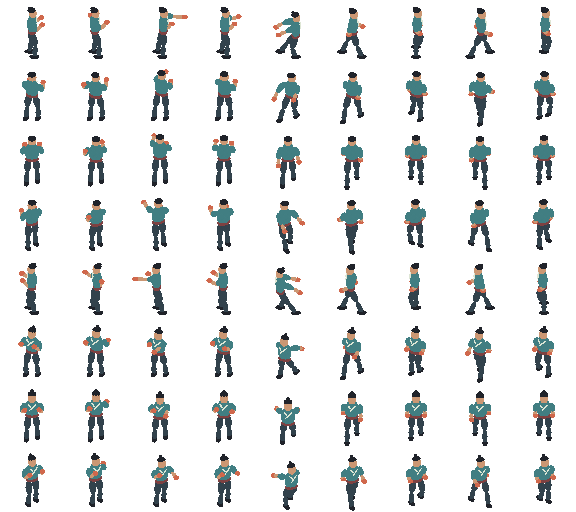
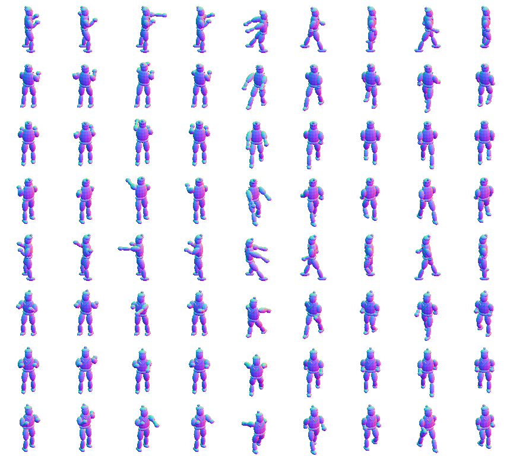

# Provenance

This repository continues a sprite pipeline that Han built in October 2026 for his own Unreal game. He built it with OpenAI Codex as a coding assistant and without version control, so the October work has no commit history. This page lists the evidence that the work existed before this repository. For each item it says what kind of evidence it is, and what it does and does not show. All times are UTC.

The repository's first commit (`9c5fe40`, 3 November 2026) imports six of the October files into [`prototype/`](../prototype/). The README's [Origin](../README.md#origin) section explains what was kept and what was left out.

## Timeline

| Time (UTC) | Event | Source |
|---|---|---|
| 2026-10-19 05:58 | `render-pose-proxy.py` and `import-pose-proxy.lua` created | file creation time |
| 2026-10-19 05:59 | `run-pose-pipeline.ps1` and `check-pose-pipeline.py` created | file creation time |
| 2026-10-19 06:02 | `PoseAtlas.h` and its tests created in the game's Unreal project | file creation time |
| 2026-10-19 06:42 | First pipeline output written: proxy atlas, Aseprite file, metadata and pose contract | file creation time |
| 2026-10-19 15:24 | `test-pose-validator.py` created | file creation time |
| 2026-10-20 02:37 to 10:06 | Last changes to the bridge, runner, validator and its tests | file write time |
| 2026-10-21 11:15 | `dan_projection.py` and the projection profile created | file creation time |
| 2026-10-21 23:15 | Last change to the projection profile | file write time |
| 2026-11-03 | This repository's first commit imports six of these files | git |

## How the pipeline developed in October

The game project keeps each experiment in its own folder under `assets/prototypes/`. 188 folders were created between 19 and 21 October: 3 on 19 October, 111 on 20 October and 74 on 21 October. Two of them are game scenes; the rest are renders, studies and reviews of the character pipeline. 37 hold a full atlas run with a pose contract, 11 an `.aseprite` file. The table groups them in order. The times are when each group's first file was created. What each step was for is read from the folder names and the contract fields.

| Time (UTC) | What the runs show | Folders |
|---|---|---|
| 2026-10-19 06:42 | First run on a proxy figure: 9 poses (idle, windup, impact, recover, dash, four walk poses) in 8 views, 64 px cells, pose contract schema 3. | `pose-locomotion` |
| 2026-10-19 23:05 | A normal-map atlas beside the colour atlas, 96 px cells. | `normal-atlas-v2` |
| 2026-10-20 00:23 to 02:38 | Motion studies on a second test character: gait, running and punch transitions. The contract grows from schema 4 to 7 as states and transitions are added. | 6 folders |
| 2026-10-20 03:38 | First runs on Dan's model, reusing those motions. | `dan-model-study-v2`, `dan-model-atlas-v2` |
| 2026-10-20 10:36 to 23:02 | Dan at 256 px cells: appearance, motion-capture review and retargeting, costume and cloth, run posture, hand grip, foot contact, guard, base body and kicks. Locomotion goes through versions 1 to 7, the representative strike (jab) through versions 1 to 15. | about 100 folders |
| 2026-10-21 01:33 to 09:24 | Review rounds on a new base model and rig, rigs and animations from an external service (folders named `dan-ai-*` and `dan-api-*`), pixel-art regression and pixel style checks, and combat trials with two strikes. | 74 folders |
| 2026-10-21 11:15 to 23:15 | The projection profile: `dan_projection.py`, `quarter-view-profile.json`, appearance landmarks and a registration to the art guide. | `tools/`, `assets/dan/` |

The first two atlases are reproduced here unchanged. Their contracts mark them `technical-proxy-not-approved-character-art`: the technique was still under development, not finished.

`provenance/2026-10-19-pose-proxy.png`: SHA-256 `25770c6092356a85badcdd0cb5ed30283a2be8518966ba151ad728a15c3e2fd1`, created 2026-10-19 06:42:14.

`provenance/2026-10-19-normal-proxy.png`: SHA-256 `5cdd88bd06e42ef78176003da9f4251fa66bb27b3341f3f5a92f44afe8e183c4`, created 2026-10-19 23:05:38.

The runs on Dan's model are not reproduced, because the character's art belongs to the game.

### What pose-atlas takes from these runs

| In October | In pose-atlas |
|---|---|
| The projection profile of 21 October (camera, eight views, pivot), written after two days of runs | One versioned camera profile with validation (Stage 1) |
| The pose contract changing from schema 3 to 7 within two days | A versioned atlas contract with stable frame keys (Stage 1, contract v2) |
| Pixel regression and pixel style checks on 21 October | Palette-locked output and its validation (done) |
| Foot contact studies on 20 October | Foot contact and sliding diagnostics (roadmap item 7) |
| Review rounds and a browser pack of two strikes on 21 October | The review page (roadmap item 8) |
| Blender as the renderer (`render-pose-proxy.py`) | A standalone renderer, so the tool no longer needs Blender |

## The imported files are the October files

Each file in `prototype/` was compared with the file in the game project on 4 November 2026. Paths are relative to the game project's folder.

| File in `prototype/` | Original | Created | Last written | SHA-256 of the original | Same bytes |
|---|---|---|---|---|---|
| `check-pose-pipeline.py` | `tools/` | 2026-10-19 05:59:55 | 2026-10-20 02:37:26 | `b05ed2b52d25615b093d11b539ef7eaf056cf63c1dca4d027e36d6ded271dd7f` | yes |
| `import-pose-proxy.lua` | `tools/` | 2026-10-19 05:58:16 | 2026-10-20 02:37:26 | `dc6db4043ee0dd257ef424e9180376998543d5b4fc5ff27074311235107efa1f` | yes |
| `test-pose-validator.py` | `tools/` | 2026-10-19 15:24:54 | 2026-10-20 10:06:32 | `f2e543d6f8a4bd863d4d597e0ece0284be6cb9fec3c288975fb78e267e32b13f` | yes |
| `dan_projection.py` | `tools/` | 2026-10-21 11:15:26 | 2026-10-21 11:15:26 | `5e01c86a7b90ec80372207e75a4c9e9159290e4fe8c1a57aca9b1e24764c7e4d` | yes |
| `quarter-view-profile.json` | `assets/dan/` | 2026-10-21 11:15:26 | 2026-10-21 23:15:16 | `217f1ab687189b1878ffd02bcc5eaf8c63cc69df95e919d6b2a2581e9b5bb86f` | yes |
| `run-pose-pipeline.ps1` | `tools/` | 2026-10-19 05:59:55 | 2026-10-20 02:37:26 | `a85622f048cf260738fe56de194743e7840eb5bd01e8e66dff553a6eac645919` | no: one default tool path changed on import |

`sha256sum prototype/*` in this repository gives the same values for the first five files.

## Other October files and outputs

Apart from the atlas reproduced above, these files stay out of the repository for the reasons given. Their hashes are listed so they can be checked against the originals.

| File | Created | Last written | SHA-256 | Why it is not here |
|---|---|---|---|---|
| `tools/render-pose-proxy.py` | 2026-10-19 05:58:16 | 2026-10-20 03:29:44 | `180f1f846e79f5d2fc37e18316bb789d8e150cc08d3c192146d1cb160b9e371e` | It uses Blender's Python API (GPL); the new renderer replaces it. |
| `PoseAtlas.h` (game's Unreal project) | 2026-10-19 06:02:23 | 2026-10-30 02:40:29 | `fec37be9ef7822c180f68d38c6c9e217c668c7c37ce9bc6f7a44b9b58a5ab4e5` | It is game code. It was changed again after 29 October. |
| `PoseAtlasTests.cpp` (game's Unreal project) | 2026-10-19 06:03:43 | 2026-10-30 02:40:59 | `15506989333d856bf2e9bfbce379241ccff5de26c6b65949053aa09bd1b76c46` | Game code. |
| `assets/prototypes/pose-locomotion/pose-contract.json` | 2026-10-19 06:42:13 | 2026-10-19 06:42:13 | `b5be9119372bfd3b31081f4fcb6cceca0334297da5f8bd714f13dfe704edb381` | Game asset folder: the output of a pipeline run (schema 3, eight views, 64×64 cells, Blender 5.2.2). |
| `assets/prototypes/pose-locomotion/pose-proxy.png` | 2026-10-19 06:42:14 | 2026-10-19 06:42:14 | `25770c6092356a85badcdd0cb5ed30283a2be8518966ba151ad728a15c3e2fd1` | Same run: the atlas. Reproduced above. |
| `assets/prototypes/pose-locomotion/pose-proxy.json` | 2026-10-19 06:42:14 | 2026-10-19 06:42:14 | `11f64d89a1970189c73d999dec734d8826b56a802487d52d79c7553664974ddf` | Same run: Aseprite-style metadata. |
| `assets/prototypes/pose-locomotion/pose-proxy.aseprite` | 2026-10-19 06:42:14 | 2026-10-19 06:42:14 | `5c3d30ea4baef15a20dccb9902bcc7602e72d11025cf82d4c61b3a9270f56fdb` | Same run: the Aseprite file. |

## What this shows, and what it does not

- **The hashes show** that the files in `prototype/` are byte for byte the files in Han's game project. They do not show when those files were written.
- **The times are filesystem metadata** on Han's PC, read on 4 November 2026. They agree with one another, and with the order in which the files depend on each other: the runner calls the render script, the bridge and the validator, and the first outputs appear about 44 minutes after the first scripts. But filesystem times can be changed, so they are not independent proof.
- **Server-side timestamps:** none found yet for this project. When the original assistant session records are reviewed, the relevant excerpts will be added here with their timestamps.

The originals, the session records and a live comparison can be shown on request, for anyone who wants to check beyond this page.
